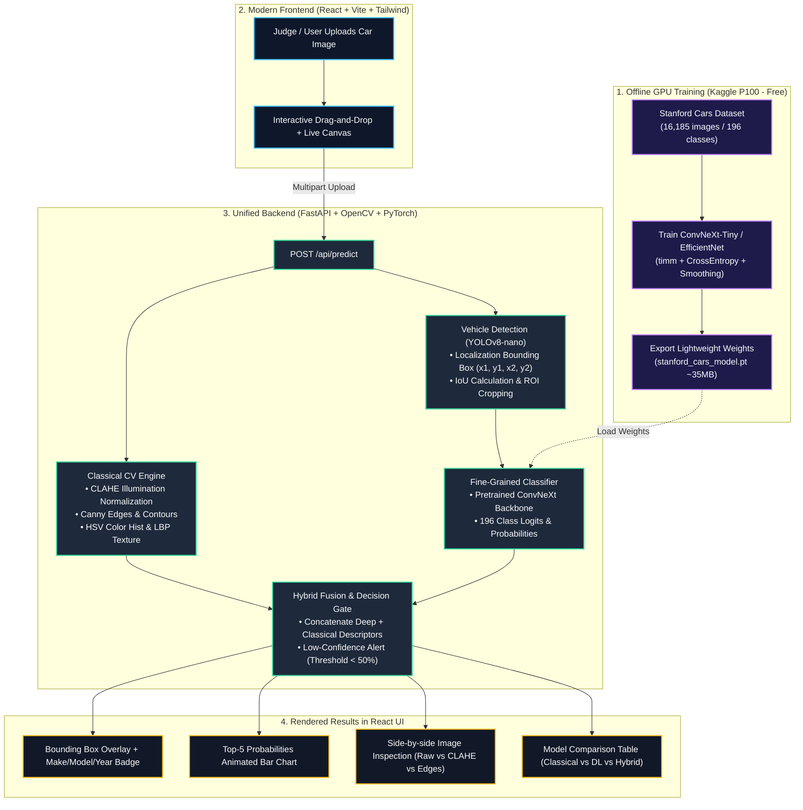

# Visionary — Intelligent Fine-Grained Vehicle Recognition System (P5)

[](https://react.dev/)
[](https://fastapi.tiangolo.com/)
[](https://pytorch.org/)
[](https://github.com/ultralytics/ultralytics)
[](https://opencv.org/)
[-yellow.svg)](https://huggingface.co/spaces)

> **Intra-College Hackathon — Problem Statement 5 (ProbID - P5)**  
> **Team ID**: `T20`  
> **Live Demo**: `[Deploying on Hugging Face Spaces]` • **GitHub**: [github.com/Sreeram5678/Visionary](https://github.com/Sreeram5678/Visionary)

---

## 📐 Master Architectural Blueprint



---

## 🛠️ The Tech Ecosystem (100% Free & Fast)

| Layer | Technology | Why We Chose It |
| :--- | :--- | :--- |
| **Frontend** | **React 18 + Vite + Tailwind CSS + Lucide** | Modern, premium glassmorphism dark-mode UI with drag-and-drop, bounding-box canvas, and side-by-side comparison sliders. |
| **Backend** | **FastAPI (Python 3.11)** | High-throughput async REST API serving both the React static frontend and PyTorch inference from a single process. |
| **Localization** | **YOLOv8-nano (`ultralytics`)** | 6.2 MB lightweight model, detects vehicles in <15ms with high IoU. |
| **Fine-Grained Classifier** | **ConvNeXt-Tiny / EfficientNet-B3 (`timm`)** | State-of-the-art accuracy across 196 Stanford Cars classes. |
| **Classical CV** | **OpenCV (`cv2`) + scikit-image** | CLAHE lighting normalization, Canny edges, contours, HSV color histograms, and LBP texture. |
| **Training GPU** | **Kaggle Notebooks (NVIDIA P100)** | Free 30 hrs/week GPU; Stanford Cars dataset is pre-indexed for instant 0-second loading. |
| **Deployment** | **Hugging Face Spaces (Docker / Python)** | **16 GB RAM + 2 vCPUs free**, no credit card, no cold-start timeouts, single public URL. |

---

## 📁 Repository Directory Structure

```text
Visionary/
├── README.md                      # THIS BLUEPRINT & PROJECT MANUAL
├── AGENTS.md                      # AI Agent operations guide & active checklist
├── eval_P5_T20.md                 # Mandatory hackathon evaluation file (USNs on Line 1)
├── docs/
│   ├── architecture_diagram.png   # Exported system architecture diagram
│   ├── design_document.md         # Full engineering design document
│   └── failure_cases.md           # 3 analyzed failure cases with root-causes
├── frontend/                      # React 18 + Vite + Tailwind CSS UI
│   ├── package.json
│   ├── vite.config.js
│   ├── tailwind.config.js
│   └── src/
│       ├── App.jsx                # Main dashboard with tabs & image upload
│       ├── components/
│       │   ├── BoundingBoxCanvas.jsx # Overlays detected vehicle box
│       │   ├── InspectionSlider.jsx  # Raw vs CLAHE / Edge comparison
│       │   ├── ConfidenceBars.jsx    # Top-5 animated probabilities
│       │   └── BenchmarkTable.jsx    # Classical vs DL vs Hybrid metrics
│       └── main.jsx
├── backend/                       # FastAPI + PyTorch + Classical CV Server
│   ├── main.py                    # API entrypoint (serves static React build + /api routes)
│   ├── requirements.txt           # Python dependencies
│   ├── weights/                   # Downloaded model checkpoints (<50MB)
│   │   └── .gitkeep
│   └── src/
│       ├── classical/
│       │   ├── preprocessing.py   # CLAHE, denoising, lighting correction
│       │   └── feature_extraction.py # Canny edges, contours, color/LBP
│       ├── detection/
│       │   └── yolo_detector.py   # YOLOv8 localization & ROI crop
│       ├── classification/
│       │   ├── dataset.py         # Stanford Cars loader (196 classes)
│       │   ├── model.py           # ConvNeXt backbone & inference
│       │   └── evaluate.py        # Top-1 & Top-5 accuracy validation
│       ├── hybrid/
│       │   └── fusion.py          # Classical + Deep feature fusion & thresholding
│       └── optimization/
│           └── quantize.py        # INT8 dynamic quantization & ONNX export
└── notebooks/
    └── stanford_cars_training_kaggle.ipynb # Ready-to-run Kaggle training script
```

---

## 🗓️ Hackathon Phased Execution Plan

```
[Phase 1] Scaffolding & Blueprint Lock-in           ✅ [COMPLETED]
   │      • GitHub repo live: @Sreeram5678/Visionary
   │      • eval_P5_T20.md initialized with mandatory USN header
   │      • Master architecture blueprint documented
   │
[Phase 2] Classical CV & YOLO Detection Engine     ⏳ [NEXT]
   │      • Build CLAHE (LAB color space) & Bilateral denoising
   │      • Build Canny edge detector & contour analyzer
   │      • Integrate YOLOv8 vehicle detection & ROI cropper
   │
[Phase 3] Classifier Training on Kaggle (Free GPU) ⏳ [PENDING]
   │      • Mount Stanford Cars on Kaggle
   │      • Fine-tune ConvNeXt-Tiny (15-20 epochs)
   │      • Save best weights (stanford_cars_convnext.pt)
   │
[Phase 4] React UI & FastAPI Integration           ⏳ [PENDING]
   │      • Scaffold React Vite + Tailwind frontend
   │      • Connect upload to /api/predict
   │      • Display BBox, Top-5 confidence bars, and CV inspection panels
   │
[Phase 5] Optimization, Evaluation & Live Deploy   ⏳ [PENDING]
   │      • Quantize classifier to INT8 (shrink size & latency)
   │      • Fill verified metrics into eval_P5_T20.md
   │      • Deploy single container to Hugging Face Spaces (get public URL)
   │
[Phase 6] 3-Minute Viva Pitch Rehearsal            ⏳ [PENDING]
          • Rehearse team presentation handling judge's live unseen photo
```

---

## ⚡ Quickstart for Local Development

### 1. Clone the repository
```bash
git clone https://github.com/Sreeram5678/Visionary.git
cd Visionary
```

### 2. Backend Setup (Python 3.11)
```bash
cd backend
python3 -m venv .venv
source .venv/bin/activate
pip install -r requirements.txt
uvicorn main:app --reload --port 8000
```

### 3. Frontend Setup (React)
```bash
cd ../frontend
npm install
npm run dev
```
Open [http://localhost:5173](http://localhost:5173) in your browser.

---

## 📋 Evaluation Criteria Reference (100 Points)
- **Demo and Viva (25 pts)**: 3-min pitch on live URL handling judge's unseen image; each member explains their component; 3 failure cases explained.
- **Evaluation Metrics (25 pts)**: Top-1/Top-5 accuracy, IoU, mAP, latency, size, robustness.
- **Implementation (20 pts)**: Unseen test images handled, train/val split, clean code, bad inputs handled gracefully.
- **UI/UX & Deployment (15 pts)**: Public URL responds in <10s on phone & laptop; one-command run; no secrets committed.
- **Documentation (15 pts)**: Architecture diagram matches code, design doc complete, `eval_P5_T20.md` strictly formatted.
